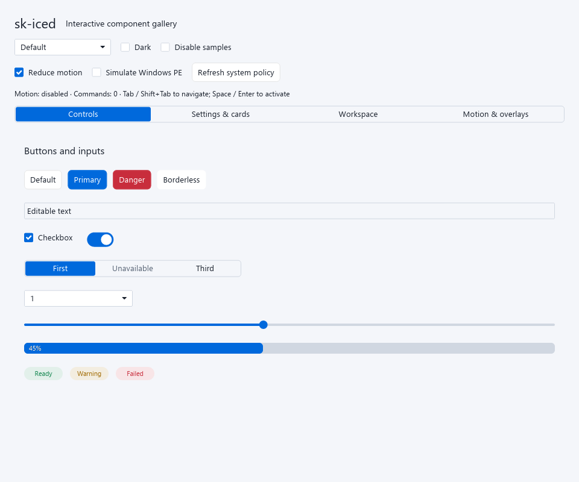
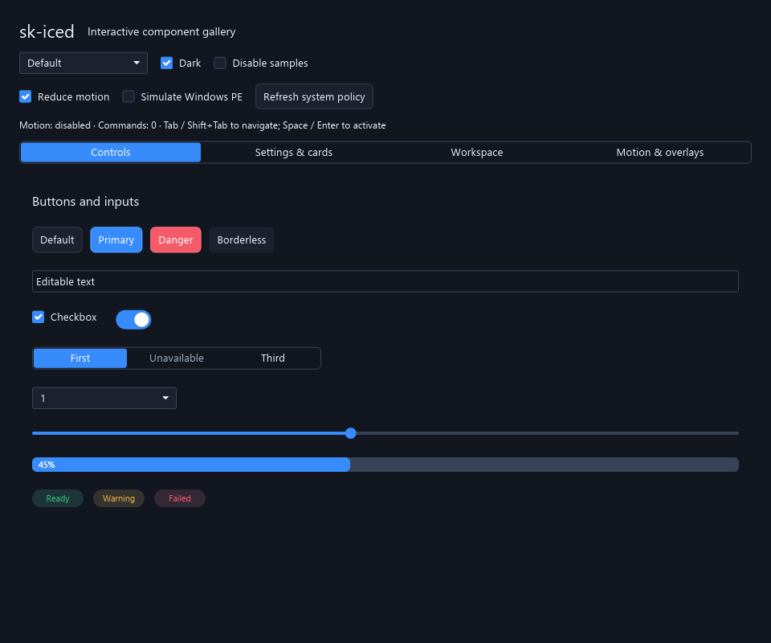

# sk-iced

Reusable UI components, themes and lightweight animations for [Iced](https://iced.rs/) 0.14.
Includes light/dark palettes, semantic design tokens, typography and icon helpers.
Applications own their data, actions and state; components handle presentation and interaction.

Animations dispatch actions immediately, redraw only while active, respect Windows’ animation
setting. Motion is disabled by default on other platforms.

Visual presets include `themes::neumorphic(tokens)`, `themes::material(tokens)`,
and `themes::metro(tokens)`. Each supports light/dark palettes and customizable surfaces.

## Getting started

Requires Rust 1.88+. Add this Git dependency alongside your Iced dependencies:

```toml
sk-iced = { git = "https://github.com/SkylerWallace/sk-iced", features = ["components"] }
iced_core = "=0.14.0"
```

```rust
use iced_core::Font;
use sk_iced::{
    animation::Element,
    components::{Appearance, ButtonTone, UiContext},
    motion::Policy,
};

let ui = UiContext::new(
    Appearance::fixed(Font::DEFAULT, sk_iced::palette::palette(true, false)),
    Policy::detect(),
);
let save: Element<'_, u8> = ui.button("Save")
    .tone(ButtonTone::Important)
    .width(120)
    .on_press(1)
    .build();
```

On Linux, also enable `x11` for standalone library builds, or supply a window
backend through your host Iced application. Windows and macOS need no X11 flag.

Builders provide defaults; override only what you need. Use `.icon(...)` for an optional
left icon, `.enabled(...)` to gate actions, and `.borderless()` for unframed buttons.
Supply your own fonts and artwork. Keep the current `Policy` in your application and call
`refresh()` when system preferences change; pass it to each animated component.

Stock tiny-skia 0.14.1 shadowed views should use an opt-in `RedrawBoundary` at
the window root. The gallery demonstrates this workaround; see the
[renderer guide](docs/renderer-compatibility.md) for its full-frame rendering cost.

## Components

Themes can define the overall look, including fonts, icon packs, gradients, shapes,
radii, layered shadows and opacity. See the [theming guide](docs/theming.md).

<details>
<summary>Controls and forms</summary>

`Button`, `Segment` / `Segmented`, `Checkbox` (including mixed state), `TextInput`,
`ToggleSwitch`, `SettingsCard`, `Slider`, `Dropdown`, `SearchableDropdown` (combobox), `Tooltip`, `SettingsRow`,
`FormField`, `FormSection`, `ChoiceGrid`, `KeyValueRow`.

```rust
let enabled = ui.toggle_switch(true).on_toggle(|_| 4u8);
let card = ui.settings_card("Notifications", enabled)
    .description("Show a notification when a transfer completes.");
let name = ui.text_input("Name", "Example").on_input(|_| 2u8);
let check = ui.checkbox(true).label("Enabled").on_toggle(|_| 3u8);
let mode = ui.segmented()
    .labels(["Light", "Dark", "Auto"])
    .selected(1)
    .on_select(|index| index as u8);
```

[Form and viewer guide](docs/forms-feedback-viewers.md)

</details>

<details>
<summary>Navigation, cards, panels and tabs</summary>

`AppShell`, `Navigation`, `NavigationItem`, `NavigationDrawer`, `Toolbar`,
`AdaptiveToolbar`, `ExpandableCard`, `Panel`, `Tab`, `TabBar`, `TabSizing`,
`TabViewport`, `TabSurface`.

```rust
use sk_iced::components::Navigation;

let navigation = Navigation::vertical()
    .spacing(4)
    .push(ui.button("Home").borderless().on_press(1u8))
    .push(ui.button("Settings").borderless().on_press(2u8));
```

[Workspace guide](docs/workspace-components.md)

</details>

<details>
<summary>Lists, tables and trees</summary>

`VirtualList`, `TreeView`, `TreeRow`, `DataTable`, `TableRow`, `TableColumns`,
`TableHeader`, `HeaderResize`, `ColumnResize`. Selection helpers: `select`,
`adjacent`, `tree_navigation` / `TreeNavigation`.

Virtual lists use fixed-height rows and a bounded cache. Applications supply stable IDs,
visible rows and selection; loading, sorting and persistence remain application concerns.

[Data component guide](docs/data-components.md)

</details>

<details>
<summary>Popups, menus, dialogs and feedback</summary>

`Popup`, `Menu`, `MenuItem`, `Dialog`, `DialogBackdrop`, `DialogCommands`,
`DialogContent`, `Notice`, `EmptyState`, `StatusBadge`, `Progress`,
`LabeledProgress`, `ShareMeter`, `FillClip`, `ReadOnlyText`, `PreviewSurface`.

```rust
use sk_iced::components::{MenuItem, ScrollArea, Scrollbar};

let item = MenuItem::new(ui.appearance, ui.motion, "Open")
    .shortcut("Ctrl+O")
    .on_press(1u8);
let menu_body = ScrollArea::new(ui.appearance, item)
    .height(200)
    .vertical(Scrollbar::embedded());
```

`DialogCommands` maps default/cancel keys; applications retain focus routing and busy-state
guards. `ReadOnlyText` borrows native editor content; `perform_read_only` handles selection
and navigation while rejecting edits.

</details>

<details>
<summary>Scrolling, resizing, splitting and drag/drop</summary>

`ScrollArea`, `Scrollbar`, `LocalScroll`, `ScrollRail`, `HorizontalScrollRail`,
`RailVisual`, `ScrollAction`, `ScrollReplay`, `ResizeGrip`, `SplitLayout`,
`SplitModel`, `DockEdge`, `DragHandle`, `DragVisibility`, `DragGesture`,
`DragRegion`, `DragRegions`, `DropIndicator`, `InteractionGate`.

Scroll positions and application state stay under application control. Split geometry,
drag cancellation and edge-scroll helpers impose no domain-specific drop behavior.

</details>

<details>
<summary>Theme, typography, icons and motion</summary>

`ThemeDefinition`, `VisualTheme`, `SurfaceStyle`, `Surface`, `Appearance`, `UiContext`, semantic `Tokens`, palette/accent helpers, `DesignTokens`,
`ControlProfile`, `RedrawBoundary`, `FocusScope`, `KeyboardControl`, `ColorRole`, `Typography`, `TextRole`, `Icon` and raster cache helpers.
Native adapters and layout/style presets support custom content and geometry.

Motion modules: `feedback` (button ripple and SVG refresh spin), `reveal`, `drawer`,
`keyed` (stable-key layout transitions), `highlight`, `responsive`, and `primitives`
(tweens, easing and ripple state). `Policy` queries
`SPI_GETCLIENTAREAANIMATION`; a failed query conservatively disables motion.

Use stable keys for moving items. Decorative transitions never delay commands or replace
application models. No global animation timer is required.

</details>

<details>
<summary>Light and dark screenshots</summary>

Output from the [interactive gallery](examples/gallery.rs), rendered headlessly
with stock Iced.




</details>

Keyboard focus, activation and optional Tab scopes are described in the
[keyboard guide](docs/keyboard.md). See also the [API contracts](docs/component-api.md)
and [stock renderer compatibility](docs/renderer-compatibility.md).

## Features and examples

| Feature | Enables |
| --- | --- |
| `theme` (default) | Palette, styles and typography |
| `animations` | Motion widgets and component APIs |
| `components` | Explicit component opt-in; includes `animations` |
| `icons` | Raster icon presentation |
| `raster-icons` | Raster resizing/cache helpers; no image codecs |
| `svg` | SVG presentation and refresh spin |
| `serde` | Serialization for supported value types |
| `x11` | X11 backend for standalone Linux library builds |

Use `default-features = false` for the standalone motion policy without Iced.
The widget types use `iced_renderer::Renderer` with software rendering enabled.

```sh
cargo run --features components --example gallery
cargo run --features components --example quick_start
cargo run --features components --example catalog -- target/catalog
cargo test --all-features
```

`gallery` opens an interactive window with style switching, disabled states,
keyboard navigation, popup focus return and motion-policy controls.
`quick_start` checks construction examples without opening a window. `catalog` writes light/dark
PPM contact sheets. Both examples work without an application event loop.

CI checks feature combinations, supported Rust, formatting, lints, tests and docs.
See [test organization](docs/testing.md), [contributing](CONTRIBUTING.md), [changelog](CHANGELOG.md) and
[release checklist](docs/releasing.md) and [validation coverage](docs/release-validation.md). The 0.1 release targets software-rendered
Iced 0.14; screen-reader support and native Linux/macOS validation are not claimed.

## License

Contains MIT and Apache-2.0 code. See [NOTICE](NOTICE), [LICENSE-MIT](LICENSE-MIT) and
[LICENSE-APACHE](LICENSE-APACHE) for attribution and applicable terms.
